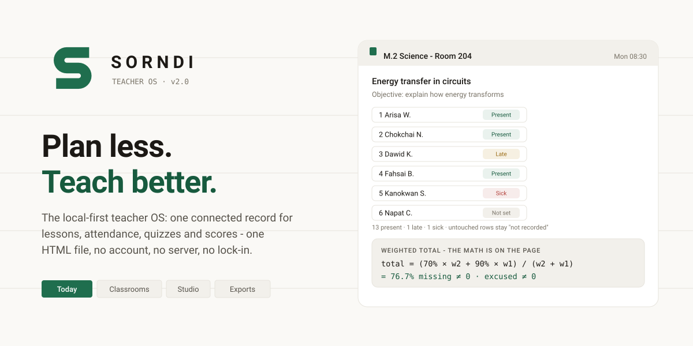
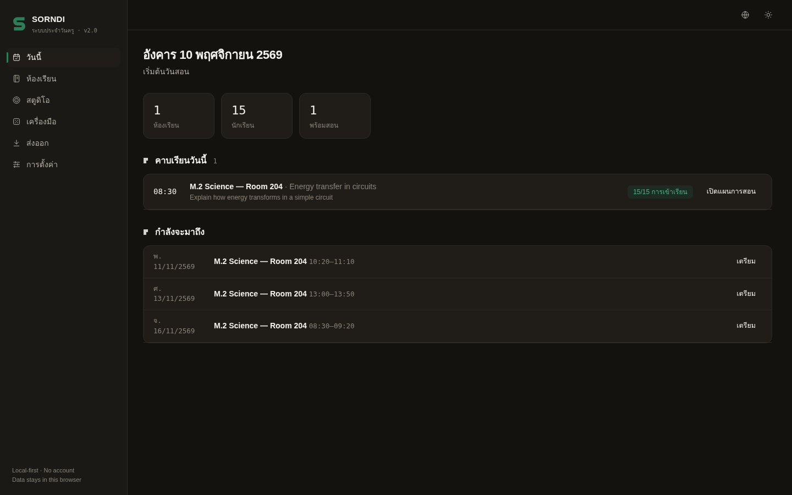
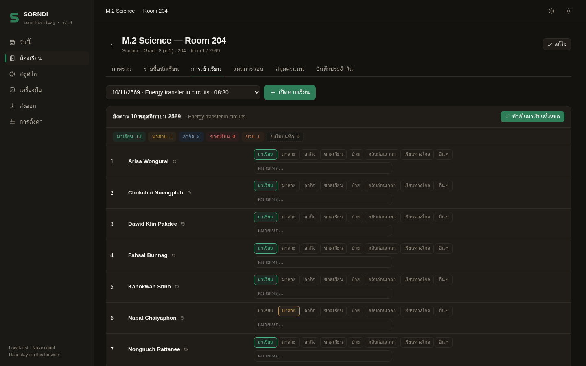
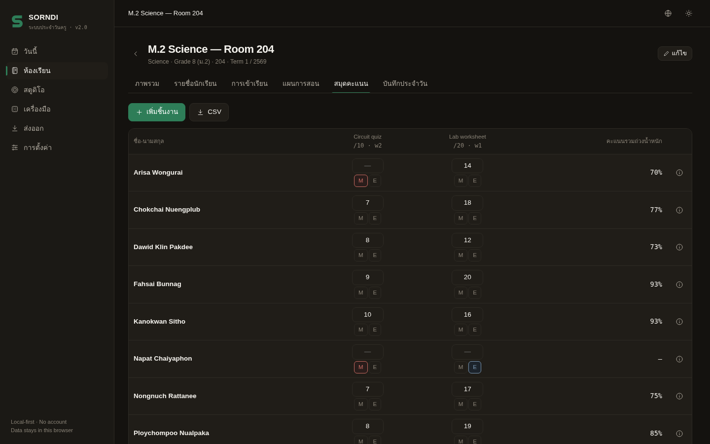
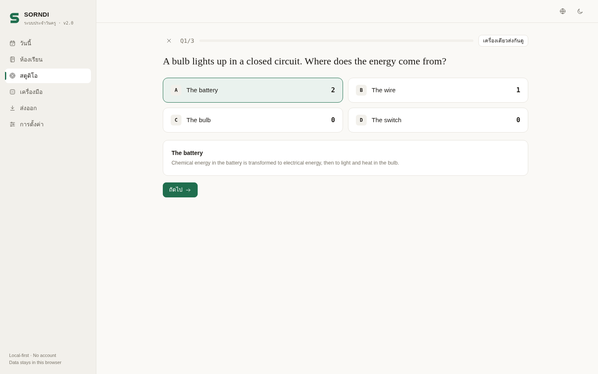
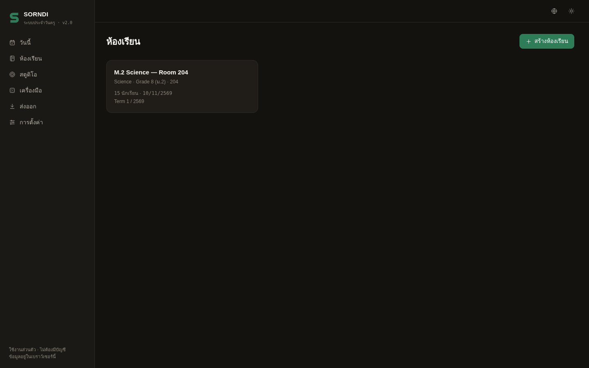
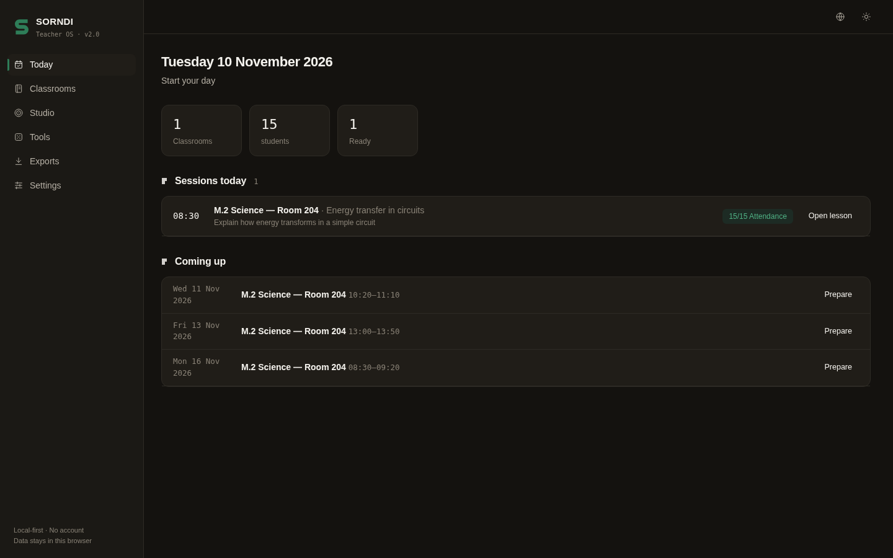
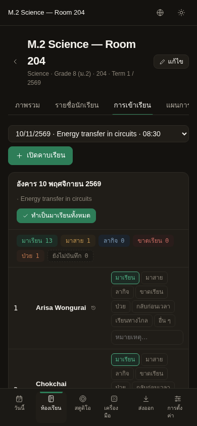

<div align="center">
  <picture>
    <source media="(prefers-color-scheme: dark)" srcset="assets/readme/hero-dark.svg">
    
  </picture>
  <p>
    <a href="#-quick-start">Quick start</a> ·
    <a href="#-what-it-does">Features</a> ·
    <a href="#-why-it-is-different">Why it is different</a> ·
    <a href="#-the-math">The math</a> ·
    <a href="#-roadmap">Roadmap</a>
  </p>
  <p>
    
    
    
    
    <a href="tests/run-tests.mjs"></a>
  </p>
</div>

---

**SornDi** (from the Thai สอนดี, "teach well") is a classroom workspace that keeps planning, attendance, evidence, games and scores connected to the teaching session — and lets the teacher walk away with every byte of it.

It runs entirely in your browser. There is no server, no sign-up, no tracking, and nothing to install: the whole app is one `index.html` file. Your classroom record lives in your browser's local storage, and a full backup is one JSON file you own.

| Today | Attendance | Scorebook | Quiz runner |
| --- | --- | --- | --- |
|  |  |  |  |

Dark mode, Thai interface, and a mobile layout for the back of the classroom:

| Dark | Thai (ไทย) | Mobile |
| --- | --- | --- |
|  |  |  |

## 🧭 What it does

| Teaching job | SornDi v2 |
| --- | --- |
| Start the day | A **Today** view built from your timetable: sessions to teach, attendance due, reflections missing, next actions. |
| Set up a class | Classrooms with subject, grade, room, term and a weekly timetable. |
| Manage the roster | Numbered students, notes, paste-import ("one per line"), archive instead of delete. |
| Plan a lesson | Objective plus an editable stage sequence generated from five evidence-informed templates, with a duration warning when the plan outgrows the timetable slot. |
| Take attendance | Eight statuses plus *not recorded*, mark-all-present first, notes, live counts, and a correction history that records who changed what and when. Rows you never touch are never counted as absent. |
| Score work | Weighted assessments where **missing is not zero and excused is not zero**, per-student weighted totals, and a "show the calculation" panel that prints the arithmetic. |
| Record the day | Teacher-defined daily record templates (homework, reading log, equipment) with an explicit absence rule you can override. |
| Run a quiz | A live multiple-choice quiz with timer, projector/tally mode (no student devices needed) or shared-device team mode, aggregate results saved to the session. |
| Small utilities | Random student picker that exhausts the roster before repeating, team maker, and a room-sized timer. |
| Take your data | Attendance CSV, scorebook CSV, daily log in Markdown, printable class report, quiz results CSV, and a complete JSON backup you can restore anywhere. |
| Work in Thai | Full English/ไทย toggle, Thai Buddhist-calendar dates, Thai-aware name sorting. |

## 🔍 Why it is different

Most teacher tools are cloud accounts. Your class lives in their database, behind their login, under their pricing. SornDi takes the opposite position, and the difference is mechanical, not marketing:

1. **One connected session record.** A teaching session links the lesson, the attendance, the quiz results, the reflection and the next action. Exports read that one object, so the report agrees with what happened.
2. **Local-first, for real.** The app is a single HTML file. No backend, no OAuth, no telemetry. Open it from a USB stick in a classroom with no internet and everything works.
3. **The arithmetic is inspectable.** Every weighted total can show its own formula, which assessments were included, and why missing or excused work was excluded. Nothing is averaged in the dark.
4. **Honest offline game mode.** The quiz runs on the projector with per-option tallies, or on one shared device in team rounds. No student accounts, no join-code server, no overpromised sync — multi-device live play is on the roadmap, not in the marketing.

The full competitor study behind these choices — HiClass, Additio, iDoceo, Wayground, Nearpod, Wordwall, ClassDojo, Gimkit, Kahoot!, with dated captures and recorded limitations — is in [docs/COMPETITIVE-ANALYSIS.md](docs/COMPETITIVE-ANALYSIS.md).

## 🚀 Quick start

**Option A — just open it.** Download `index.html` and double-click it. That is the whole install.

**Option B — clone the repo.**

```bash
git clone https://github.com/Tulip9ZZZA/sorndi.git
cd sorndi
open index.html        # macOS
# or: xdg-open index.html  (Linux)
# or: start index.html     (Windows)
```

**Option C — serve it** (nicer URLs, same app):

```bash
npx serve .            # or: python3 -m http.server 8080
```

**Option D — GitHub Pages.** Enable Pages on the `main` branch in your fork's settings; the app at the repo root *is* the site.

First run: **Settings → Load demo class** gives you a realistic Grade 8 science class with 15 students, a taught session, scored assessments and a quiz — good for exploring before you trust it with real rosters.

**Try the loop the MVP promises:** create a class → paste your roster → generate a lesson from a template → open a session → take attendance → run the exit quiz in projector mode → write the reflection → export the daily log.

Run the tests (Node 18+, no dependencies to install):

```bash
npm test               # runs: node tests/run-tests.mjs
```

## 🧮 The math

The scorebook policy is explicit:

```text
percentage(a)   = score / max_score × 100          (skipped when missing or excused)
weighted_total  = Σ(percentage × weight) / Σ(weight)

missing  → excluded from both sums, reported as "Missing: n (excluded)"
excused  → excluded from both sums, reported as "Excused: n (excluded)"
out-of-range scores are ignored, never invented
```

Every student's total has an info button that prints exactly this breakdown for that student. The same functions power the app and the test suite ([lib/sorndi-core.mjs](lib/sorndi-core.mjs), [tests/run-tests.mjs](tests/run-tests.mjs)).

## 🔐 Your data

- Everything is stored in your browser's local storage under one key (`sorndi.v2`). Nothing leaves the device — the app makes zero network requests.
- **Exports → Full backup (JSON)** produces a complete, human-readable copy. **Restore** replaces current data with a backup file.
- Erasing is explicit: type `ERASE` to confirm.
- Student privacy rules are built in: no student accounts, no public pages, no health data, no behavioural scoring. Details in [docs/DATA-AND-PRIVACY.md](docs/DATA-AND-PRIVACY.md).

## 🗺 Roadmap

| Priority | Capability | Status |
| --- | --- | --- |
| P0 | Class, roster, timetable, Today | ✅ v2.0 |
| P0 | Lesson templates with duration validation | ✅ v2.0 |
| P0 | Sessions, attendance with correction history | ✅ v2.0 |
| P0 | Live quiz: projector/tally + shared-device modes | ✅ v2.0 |
| P0 | Exports: CSV, Markdown, print, JSON backup | ✅ v2.0 |
| P1 | Multi-device live quiz over the local network (WebRTC, no internet) | Planned |
| P1 | Spaced review queue driven by objectives and evidence | Planned |
| P1 | QR attendance with manual fallback | Planned |
| P2 | Objectives bank and objective-to-evidence mapping | Planned |
| P2 | Open resource packs: import/export lessons and quizzes as files | Planned |
| P3 | Community library with attribution and remix licences | Exploring |

## 🤝 Contributing

Issues and pull requests are welcome. Because the app is dependency-free vanilla JS, the bar for contributing is low: read [CONTRIBUTING.md](CONTRIBUTING.md), keep the design system consistent ([docs/BRAND.md](docs/BRAND.md)), and add a test when you touch the domain logic.

Please never commit real student names, scores, or any personal classroom data.

## 📄 License

[MIT](LICENSE) — use it, fork it, run it at your school, build your business on it. The name and logo are SornDi's; the code is yours.

## 🙏 Acknowledgements

SornDi v2 was designed with a stack of open agent skills: the [logo-design](https://github.com/kaankiziltug/logo-design-skill) process for the Ledger-S mark, [brand-skills](https://github.com/cofoundy/brand-skills) for the identity system, [unslop](https://github.com/heydamir/unslop) for the interface discipline, [beautify-github-readme](https://github.com/oil-oil/beautify-github-readme) for this page, and an REA-style evidence discipline for the competitive teardown. Learning-science structure of the lesson templates follows retrieval practice and worked-example guidance summarised by AERO's spacing and retrieval guide.
